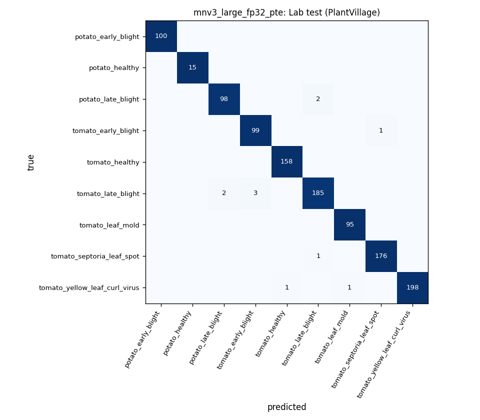
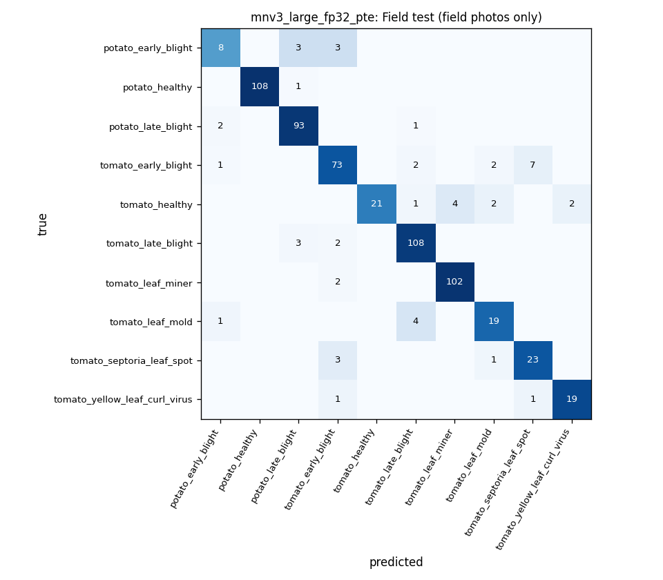

# Results: mnv3_large_fp32_pte

Model: mnv3_large_fp32.pte (ExecuTorch FP32, XNNPACK) through the Python runtime, temperature 0.709

| set | images | accuracy | macro F1 | crop known accuracy | crop known macro F1 | wrong crop |
|---|---|---|---|---|---|---|
| Lab test (PlantVillage) | 1135 | 0.9903 | 0.9911 | 0.9938 | 0.9945 | 0.0035 |
| Field test (field photos only) | 623 | 0.9213 | 0.8651 | 0.9342 | 0.8907 | 0.0144 |

## Lab test (PlantVillage), per class

| class | precision | recall | F1 | images |
|---|---|---|---|---|
| potato_early_blight | 1.000 | 1.000 | 1.000 | 100 |
| potato_healthy | 1.000 | 1.000 | 1.000 | 15 |
| potato_late_blight | 0.980 | 0.980 | 0.980 | 100 |
| tomato_early_blight | 0.971 | 0.990 | 0.980 | 100 |
| tomato_healthy | 0.994 | 1.000 | 0.997 | 158 |
| tomato_late_blight | 0.984 | 0.974 | 0.979 | 190 |
| tomato_leaf_mold | 0.990 | 1.000 | 0.995 | 95 |
| tomato_septoria_leaf_spot | 0.994 | 0.994 | 0.994 | 177 |
| tomato_yellow_leaf_curl_virus | 1.000 | 0.990 | 0.995 | 200 |

## Field test (field photos only), per class

| class | precision | recall | F1 | images |
|---|---|---|---|---|
| potato_early_blight | 0.667 | 0.571 | 0.615 | 14 |
| potato_healthy | 1.000 | 0.991 | 0.995 | 109 |
| potato_late_blight | 0.930 | 0.969 | 0.949 | 96 |
| tomato_early_blight | 0.869 | 0.859 | 0.864 | 85 |
| tomato_healthy | 1.000 | 0.700 | 0.824 | 30 |
| tomato_late_blight | 0.931 | 0.956 | 0.943 | 113 |
| tomato_leaf_miner | 0.962 | 0.981 | 0.971 | 104 |
| tomato_leaf_mold | 0.792 | 0.792 | 0.792 | 24 |
| tomato_septoria_leaf_spot | 0.742 | 0.852 | 0.793 | 27 |
| tomato_yellow_leaf_curl_virus | 0.905 | 0.905 | 0.905 | 21 |

