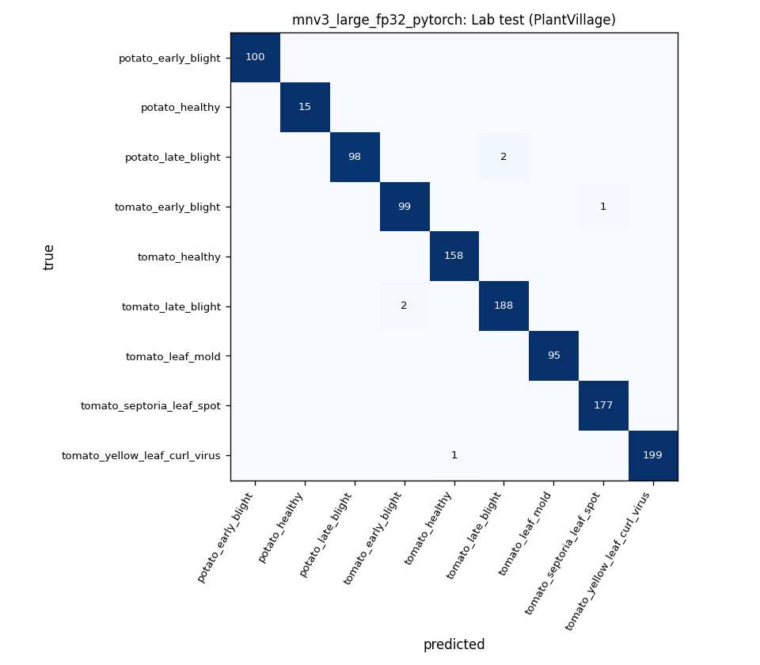
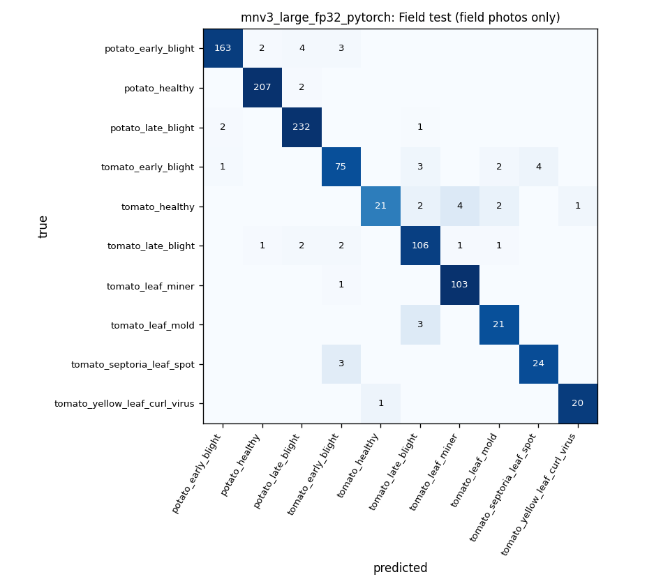

# Results: mnv3_large_fp32_pytorch

Model: PyTorch FP32 checkpoint, MobileNetV3-large, input 224, temperature 0.687

| set | images | accuracy | macro F1 | crop known accuracy | crop known macro F1 | wrong crop |
|---|---|---|---|---|---|---|
| Lab test (PlantVillage) | 1135 | 0.9947 | 0.9951 | 0.9965 | 0.9968 | 0.0018 |
| Field test (field photos only) | 1020 | 0.9529 | 0.9191 | 0.9588 | 0.9226 | 0.0078 |

## Lab test (PlantVillage), per class

| class | precision | recall | F1 | images |
|---|---|---|---|---|
| potato_early_blight | 1.000 | 1.000 | 1.000 | 100 |
| potato_healthy | 1.000 | 1.000 | 1.000 | 15 |
| potato_late_blight | 1.000 | 0.980 | 0.990 | 100 |
| tomato_early_blight | 0.980 | 0.990 | 0.985 | 100 |
| tomato_healthy | 0.994 | 1.000 | 0.997 | 158 |
| tomato_late_blight | 0.989 | 0.989 | 0.989 | 190 |
| tomato_leaf_mold | 1.000 | 1.000 | 1.000 | 95 |
| tomato_septoria_leaf_spot | 0.994 | 1.000 | 0.997 | 177 |
| tomato_yellow_leaf_curl_virus | 1.000 | 0.995 | 0.997 | 200 |

## Field test (field photos only), per class

| class | precision | recall | F1 | images |
|---|---|---|---|---|
| potato_early_blight | 0.982 | 0.948 | 0.964 | 172 |
| potato_healthy | 0.986 | 0.990 | 0.988 | 209 |
| potato_late_blight | 0.967 | 0.987 | 0.977 | 235 |
| tomato_early_blight | 0.893 | 0.882 | 0.888 | 85 |
| tomato_healthy | 0.955 | 0.700 | 0.808 | 30 |
| tomato_late_blight | 0.922 | 0.938 | 0.930 | 113 |
| tomato_leaf_miner | 0.954 | 0.990 | 0.972 | 104 |
| tomato_leaf_mold | 0.808 | 0.875 | 0.840 | 24 |
| tomato_septoria_leaf_spot | 0.857 | 0.889 | 0.873 | 27 |
| tomato_yellow_leaf_curl_virus | 0.952 | 0.952 | 0.952 | 21 |

