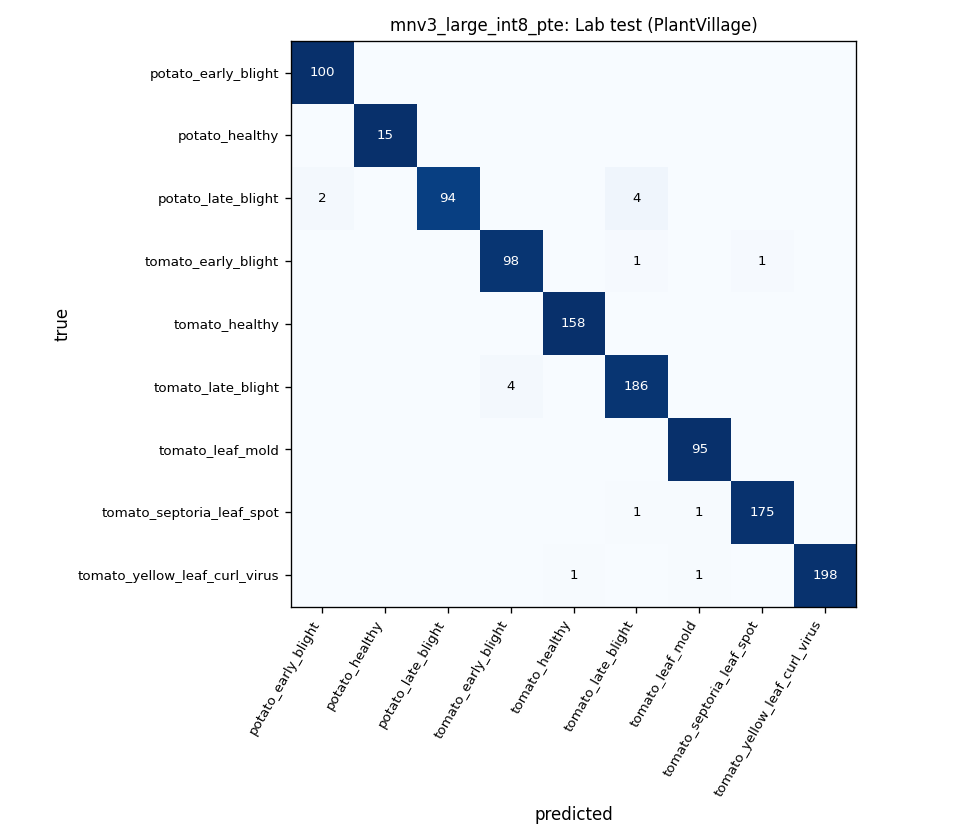
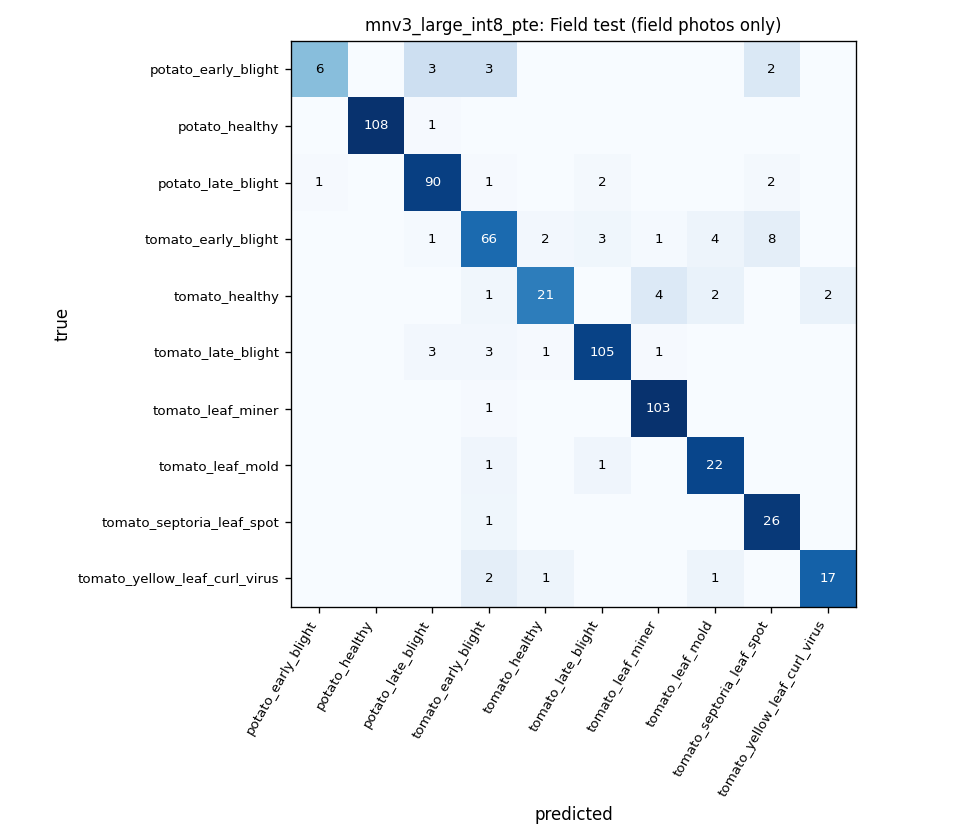

# Results: mnv3_large_int8_pte

Model: mnv3_large_int8.pte (ExecuTorch INT8, XNNPACK) through the Python runtime, temperature 0.709

| set | images | accuracy | macro F1 | crop known accuracy | crop known macro F1 | wrong crop |
|---|---|---|---|---|---|---|
| Lab test (PlantVillage) | 1135 | 0.9859 | 0.9862 | 0.9894 | 0.9897 | 0.0035 |
| Field test (field photos only) | 623 | 0.9053 | 0.8448 | 0.9262 | 0.8862 | 0.0225 |

## Lab test (PlantVillage), per class

| class | precision | recall | F1 | images |
|---|---|---|---|---|
| potato_early_blight | 0.980 | 1.000 | 0.990 | 100 |
| potato_healthy | 1.000 | 1.000 | 1.000 | 15 |
| potato_late_blight | 1.000 | 0.940 | 0.969 | 100 |
| tomato_early_blight | 0.961 | 0.980 | 0.970 | 100 |
| tomato_healthy | 0.994 | 1.000 | 0.997 | 158 |
| tomato_late_blight | 0.969 | 0.979 | 0.974 | 190 |
| tomato_leaf_mold | 0.979 | 1.000 | 0.990 | 95 |
| tomato_septoria_leaf_spot | 0.994 | 0.989 | 0.992 | 177 |
| tomato_yellow_leaf_curl_virus | 1.000 | 0.990 | 0.995 | 200 |

## Field test (field photos only), per class

| class | precision | recall | F1 | images |
|---|---|---|---|---|
| potato_early_blight | 0.857 | 0.429 | 0.571 | 14 |
| potato_healthy | 1.000 | 0.991 | 0.995 | 109 |
| potato_late_blight | 0.918 | 0.938 | 0.928 | 96 |
| tomato_early_blight | 0.835 | 0.776 | 0.805 | 85 |
| tomato_healthy | 0.840 | 0.700 | 0.764 | 30 |
| tomato_late_blight | 0.946 | 0.929 | 0.938 | 113 |
| tomato_leaf_miner | 0.945 | 0.990 | 0.967 | 104 |
| tomato_leaf_mold | 0.759 | 0.917 | 0.830 | 24 |
| tomato_septoria_leaf_spot | 0.684 | 0.963 | 0.800 | 27 |
| tomato_yellow_leaf_curl_virus | 0.895 | 0.810 | 0.850 | 21 |

