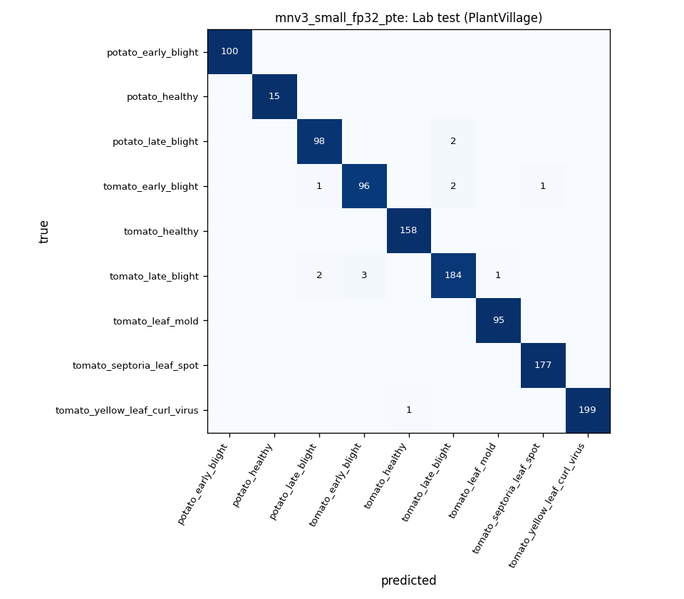
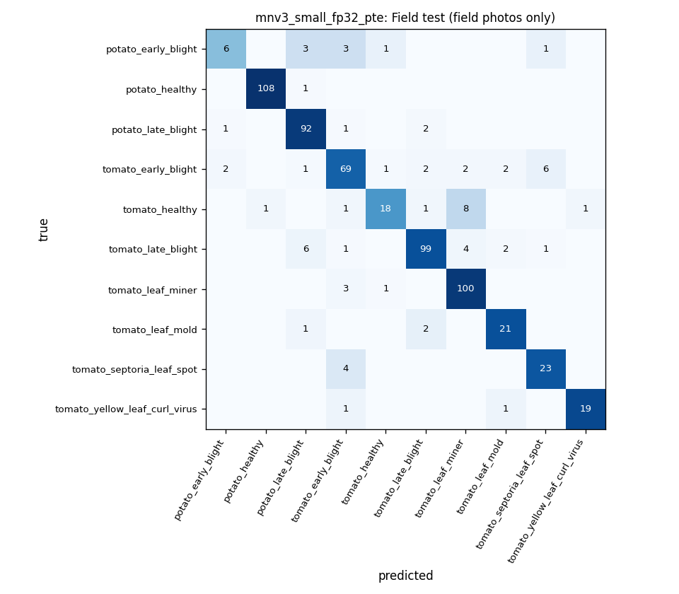

# Results: mnv3_small_fp32_pte

Model: mnv3_small_fp32.pte (ExecuTorch FP32, XNNPACK) through the Python runtime, temperature 0.687

| set | images | accuracy | macro F1 | crop known accuracy | crop known macro F1 | wrong crop |
|---|---|---|---|---|---|---|
| Lab test (PlantVillage) | 1135 | 0.9885 | 0.9889 | 0.9921 | 0.9925 | 0.0044 |
| Field test (field photos only) | 623 | 0.8909 | 0.8341 | 0.9149 | 0.8774 | 0.0305 |

## Lab test (PlantVillage), per class

| class | precision | recall | F1 | images |
|---|---|---|---|---|
| potato_early_blight | 1.000 | 1.000 | 1.000 | 100 |
| potato_healthy | 1.000 | 1.000 | 1.000 | 15 |
| potato_late_blight | 0.970 | 0.980 | 0.975 | 100 |
| tomato_early_blight | 0.970 | 0.960 | 0.965 | 100 |
| tomato_healthy | 0.994 | 1.000 | 0.997 | 158 |
| tomato_late_blight | 0.979 | 0.968 | 0.974 | 190 |
| tomato_leaf_mold | 0.990 | 1.000 | 0.995 | 95 |
| tomato_septoria_leaf_spot | 0.994 | 1.000 | 0.997 | 177 |
| tomato_yellow_leaf_curl_virus | 1.000 | 0.995 | 0.997 | 200 |

## Field test (field photos only), per class

| class | precision | recall | F1 | images |
|---|---|---|---|---|
| potato_early_blight | 0.667 | 0.429 | 0.522 | 14 |
| potato_healthy | 0.991 | 0.991 | 0.991 | 109 |
| potato_late_blight | 0.885 | 0.958 | 0.920 | 96 |
| tomato_early_blight | 0.831 | 0.812 | 0.821 | 85 |
| tomato_healthy | 0.857 | 0.600 | 0.706 | 30 |
| tomato_late_blight | 0.934 | 0.876 | 0.904 | 113 |
| tomato_leaf_miner | 0.877 | 0.962 | 0.917 | 104 |
| tomato_leaf_mold | 0.808 | 0.875 | 0.840 | 24 |
| tomato_septoria_leaf_spot | 0.742 | 0.852 | 0.793 | 27 |
| tomato_yellow_leaf_curl_virus | 0.950 | 0.905 | 0.927 | 21 |

