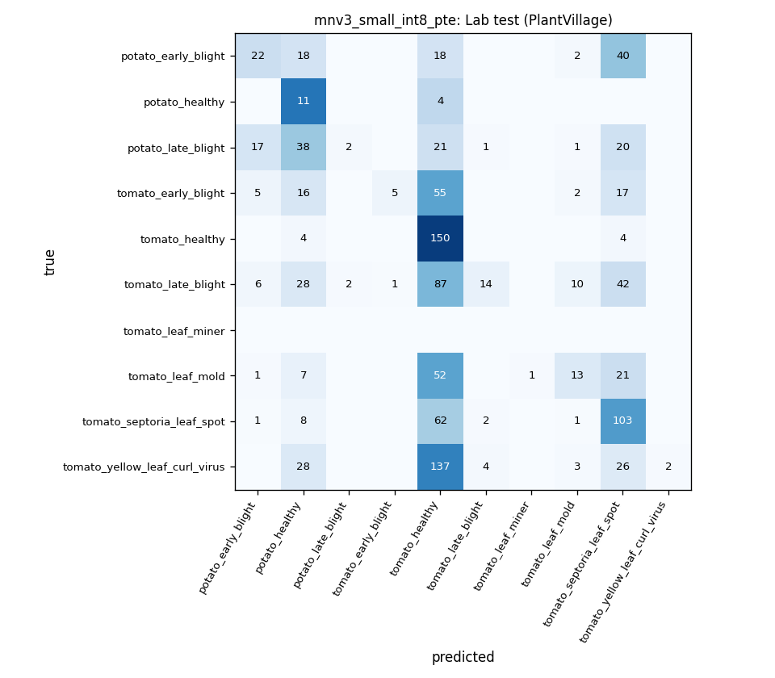
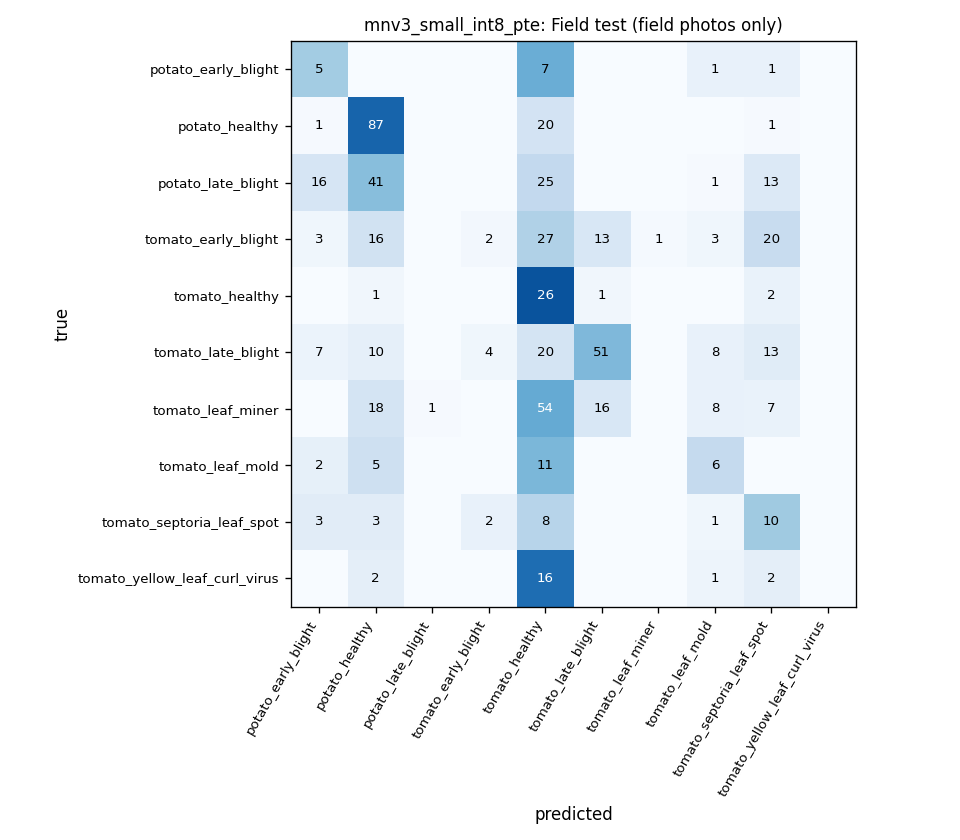

# Results: mnv3_small_int8_pte

Model: mnv3_small_int8.pte (ExecuTorch INT8, XNNPACK) through the Python runtime, temperature 0.687

| set | images | accuracy | macro F1 | crop known accuracy | crop known macro F1 | wrong crop |
|---|---|---|---|---|---|---|
| Lab test (PlantVillage) | 1135 | 0.2837 | 0.1964 | 0.3172 | 0.2447 | 0.1877 |
| Field test (field photos only) | 623 | 0.3002 | 0.2009 | 0.3563 | 0.2542 | 0.2247 |

## Lab test (PlantVillage), per class

| class | precision | recall | F1 | images |
|---|---|---|---|---|
| potato_early_blight | 0.423 | 0.220 | 0.289 | 100 |
| potato_healthy | 0.070 | 0.733 | 0.127 | 15 |
| potato_late_blight | 0.500 | 0.020 | 0.038 | 100 |
| tomato_early_blight | 0.833 | 0.050 | 0.094 | 100 |
| tomato_healthy | 0.256 | 0.949 | 0.403 | 158 |
| tomato_late_blight | 0.667 | 0.074 | 0.133 | 190 |
| tomato_leaf_mold | 0.406 | 0.137 | 0.205 | 95 |
| tomato_septoria_leaf_spot | 0.377 | 0.582 | 0.458 | 177 |
| tomato_yellow_leaf_curl_virus | 1.000 | 0.010 | 0.020 | 200 |

## Field test (field photos only), per class

| class | precision | recall | F1 | images |
|---|---|---|---|---|
| potato_early_blight | 0.135 | 0.357 | 0.196 | 14 |
| potato_healthy | 0.475 | 0.798 | 0.596 | 109 |
| potato_late_blight | 0.000 | 0.000 | 0.000 | 96 |
| tomato_early_blight | 0.250 | 0.024 | 0.043 | 85 |
| tomato_healthy | 0.121 | 0.867 | 0.213 | 30 |
| tomato_late_blight | 0.630 | 0.451 | 0.526 | 113 |
| tomato_leaf_miner | 0.000 | 0.000 | 0.000 | 104 |
| tomato_leaf_mold | 0.207 | 0.250 | 0.226 | 24 |
| tomato_septoria_leaf_spot | 0.145 | 0.370 | 0.208 | 27 |
| tomato_yellow_leaf_curl_virus | 0.000 | 0.000 | 0.000 | 21 |

