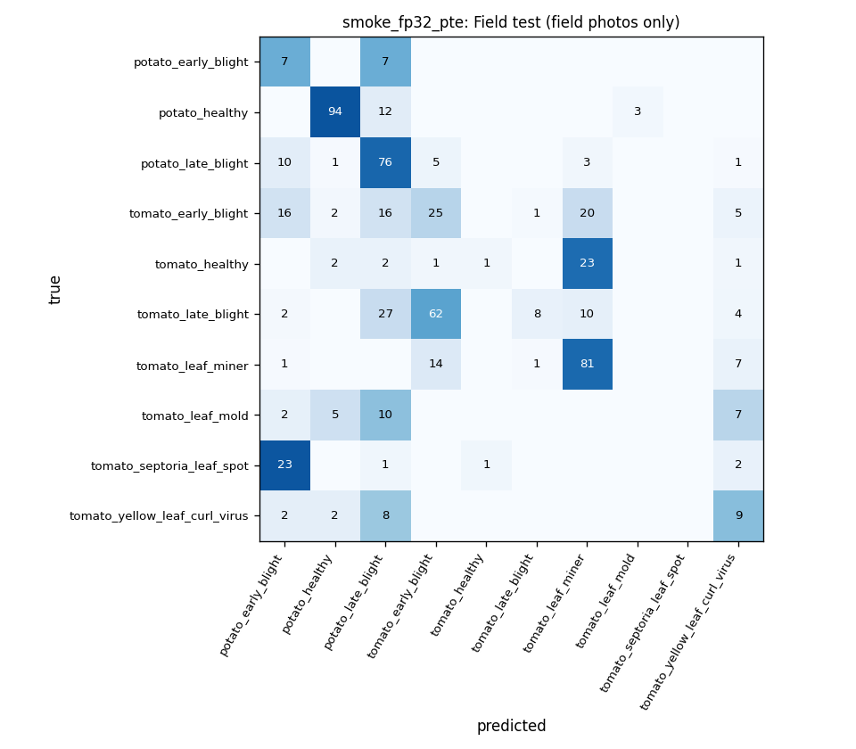

# Results: smoke_fp32_pte

Model: smoke_fp32.pte (ExecuTorch FP32, XNNPACK) through the Python runtime, temperature 0.472

| set | images | accuracy | macro F1 | crop known accuracy | crop known macro F1 | wrong crop |
|---|---|---|---|---|---|---|
| Field test (field photos only) | 623 | 0.4831 | 0.3093 | 0.5490 | 0.4111 | 0.2135 |

## Field test (field photos only), per class

| class | precision | recall | F1 | images |
|---|---|---|---|---|
| potato_early_blight | 0.111 | 0.500 | 0.182 | 14 |
| potato_healthy | 0.887 | 0.862 | 0.874 | 109 |
| potato_late_blight | 0.478 | 0.792 | 0.596 | 96 |
| tomato_early_blight | 0.234 | 0.294 | 0.260 | 85 |
| tomato_healthy | 0.500 | 0.033 | 0.062 | 30 |
| tomato_late_blight | 0.800 | 0.071 | 0.130 | 113 |
| tomato_leaf_miner | 0.591 | 0.779 | 0.672 | 104 |
| tomato_leaf_mold | 0.000 | 0.000 | 0.000 | 24 |
| tomato_septoria_leaf_spot | 0.000 | 0.000 | 0.000 | 27 |
| tomato_yellow_leaf_curl_virus | 0.250 | 0.429 | 0.316 | 21 |

