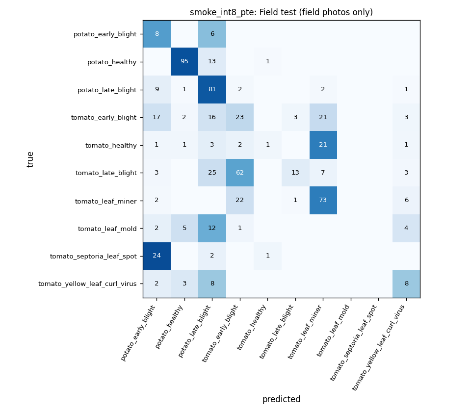

# Results: smoke_int8_pte

Model: smoke_int8.pte (ExecuTorch INT8, XNNPACK) through the Python runtime, temperature 0.472

| set | images | accuracy | macro F1 | crop known accuracy | crop known macro F1 | wrong crop |
|---|---|---|---|---|---|---|
| Field test (field photos only) | 623 | 0.4848 | 0.3168 | 0.5425 | 0.4092 | 0.2151 |

## Field test (field photos only), per class

| class | precision | recall | F1 | images |
|---|---|---|---|---|
| potato_early_blight | 0.118 | 0.571 | 0.195 | 14 |
| potato_healthy | 0.888 | 0.872 | 0.880 | 109 |
| potato_late_blight | 0.488 | 0.844 | 0.618 | 96 |
| tomato_early_blight | 0.205 | 0.271 | 0.234 | 85 |
| tomato_healthy | 0.333 | 0.033 | 0.061 | 30 |
| tomato_late_blight | 0.765 | 0.115 | 0.200 | 113 |
| tomato_leaf_miner | 0.589 | 0.702 | 0.640 | 104 |
| tomato_leaf_mold | 0.000 | 0.000 | 0.000 | 24 |
| tomato_septoria_leaf_spot | 0.000 | 0.000 | 0.000 | 27 |
| tomato_yellow_leaf_curl_virus | 0.308 | 0.381 | 0.340 | 21 |

